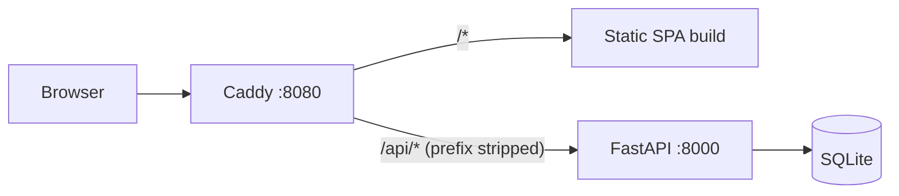
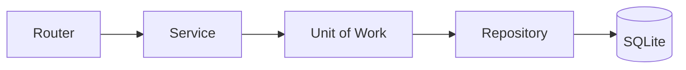

# todo-app

A minimal personal task tracker: a FastAPI + SQLite backend and a React single-page app,
available in English and Russian.

## Features

- Sign up and sign in with a username and password (JWT bearer tokens).
- Notes with a title, an optional body and due date, a status (`todo`, `in_progress`, `done`,
  or none for a plain note), and any number of categories.
- Personal categories with names that are unique regardless of case.
- Note list filtered by status, category and due date range, with pagination.
- Soft delete everywhere: deleted records stay in the database and disappear from the API.
- Every user sees only their own data.
- English and Russian UI with a language switcher. Dates are shown in the browser's time zone.

## Architecture



The browser talks to a single origin. The reverse proxy serves the built SPA and forwards
`/api/*` to the backend, so no CORS is needed. In development the Vite dev server plays the
proxy's role.

### Backend



- **Routers** (`app/api/`) handle HTTP, validate input with Pydantic and map domain
  exceptions to status codes. They hold no business logic and no sessions.
- **Services** (`app/services/`) own the transaction. Each public method opens one
  `unit_of_work`, which yields a session and the repositories bound to it. The transaction
  commits on success and rolls back on any exception. Services return Pydantic schemas,
  never ORM objects, and never call each other.
- **Repositories** (`app/repositories/`) build queries and never commit. `BaseRepository`
  always filters out soft-deleted rows and other users' rows, and fills the audit fields.
- **Data model.** `users`, `notes` and `categories` share one set of base fields: `id`
  (uuid4), `status`, `created_at`, `updated_at`, `created_by`, `updated_by` and `deleted_at`.
  `created_by` is the owner. Notes and categories are linked many-to-many through
  `note_category`. Uniqueness is enforced by partial unique indexes that ignore deleted rows.
  Category names are compared by a `casefold()` key, so case-insensitivity works beyond ASCII.
- **Auth.** Passwords are hashed with argon2 (`pwdlib`). Access tokens are HS256 JWTs
  (PyJWT) that live 60 minutes. There are no refresh tokens.
- **Errors.** `409` and domain `422` responses use FastAPI's list format,
  `{"detail": [{"loc": [...], "msg": "...", "type": "conflict"}]}`, so clients handle both the
  same way. All error responses are described in the OpenAPI schema.
- **Migrations.** Alembic runs in async, batch mode, which SQLite needs to alter tables.

### API contract

`openapi.json` in the repository root is a snapshot of the API schema.

- The backend owns it: `scripts/export_openapi.py` writes it, and a test fails if the snapshot
  differs from the running app.
- The frontend generates its types from it (`npm run api:gen`). `npm run api:check` fails when
  those types are stale.
- A renamed endpoint, field or enum value therefore breaks the frontend typecheck rather than
  production.

### Frontend

- **Stack.** Vite, React, TypeScript, TanStack Router and TanStack Query, with `openapi-fetch`
  as the typed API client.
- **Filters and pagination** live in typed URL search params. The list loads more pages on
  demand. Status changes are optimistic.
- **Session expiry.** A `401` on an authenticated request opens a sign-in dialog over the
  current page, so unsaved input stays. The note editor also keeps a local draft until a save
  succeeds.
- **i18n.** Built on `i18next` and `react-i18next`:
  - English is the default and fallback language; Russian is the second one.
  - The language comes from the saved choice, otherwise from the browser.
  - Translation keys are typed, so a missing key is a compile error.
  - API errors are translated by their `type` and field. The server's message is only a
    fallback.

### Repository layout

```
app/                  FastAPI application
  api/                routers and dependencies
  services/           business logic, unit of work
  repositories/       data access
  models/             SQLAlchemy models
  schemas/            Pydantic schemas
migrations/           Alembic migrations
scripts/              export_openapi.py
tests/                backend tests
frontend/             React SPA
  src/api/            generated schema, client, error mapping, queries
  src/auth/           session, sign-in and sign-up
  src/features/       notes and categories
  src/i18n/           i18n setup and locales (en.json, ru.json)
docker/               web image and Caddyfile
Dockerfile            backend image
docker-compose.yml    full stack
openapi.json          API contract snapshot
```

## Deployment with Docker

Requirements: Docker with the Compose plugin.

```bash
export JWT_SECRET="$(python3 -c 'import secrets; print(secrets.token_urlsafe(48))')"
docker compose up -d --build
```

| URL | What |
|---|---|
| http://localhost:8080 | the app |
| http://localhost:8080/api | the API |
| http://localhost:8080/api/docs | Swagger UI |

```bash
docker compose down      # stop; data is kept
docker compose down -v   # stop and delete the database volume
```

### What runs

- **`backend`** (`Dockerfile`):
  - Python 3.14 slim with dependencies installed by `uv` from `uv.lock`, running as an
    unprivileged user.
  - On start it applies migrations (`alembic upgrade head`), then runs
    `fastapi run --root-path /api` on port 8000.
  - The port is not published; only `web` reaches it.
  - SQLite lives in the `todo-data` volume at `/data/todo.db`.
- **`web`** (`docker/frontend.Dockerfile`):
  - Node builds the SPA, then Caddy serves it on port 80 (published as 8080).
  - Caddy falls back to `index.html` for client-side routes and proxies `/api/*` to `backend`.
  - It starts once the backend health check passes.

### Configuration

| Variable | Default | Notes |
|---|---|---|
| `JWT_SECRET` | none | Required, at least 32 characters. Compose refuses to start without it. Can also be set in `.env` next to `docker-compose.yml`. |
| `JWT_ALGORITHM` | `HS256` | |
| `JWT_TTL_MINUTES` | `60` | |
| `DATABASE_URL` | `sqlite+aiosqlite:///./todo.db` | Set to `sqlite+aiosqlite:////data/todo.db` in the image. |

Caddy serves plain HTTP. To expose the app publicly, put it behind a TLS-terminating proxy
or give Caddy a domain name.

## Local development

Requirements: Python 3.14 with [uv](https://docs.astral.sh/uv/), and Node.js 20.19 or newer
with npm 11. npm 10.8 fails on this lockfile; use `npx npm@11 install`.

Backend:

```bash
cp .env.example .env   # then set JWT_SECRET
uv sync
uv run alembic upgrade head
uv run fastapi dev app/main.py --root-path /api
```

Frontend, in another terminal:

```bash
cd frontend
npm install
npm run dev            # http://localhost:5173, proxies /api/* to http://localhost:8000
```

Set `API_URL` to point the dev proxy at another backend address.

After changing the API, refresh the contract and the frontend types:

```bash
uv run python scripts/export_openapi.py
cd frontend && npm run api:gen
```

## Checks

```bash
uv run pytest                                          # backend tests
uv run ruff check . && uv run ruff format --check .    # lint and formatting
cd frontend && npm run check                           # contract, typecheck, lint, tests
```

The backend test suite includes a hygiene check: Cyrillic text is allowed only in
`frontend/src/i18n/locales/ru.json`.
