<a id="readme-top"></a>

<div align="center">
  

  <h1>todo-app</h1>

  <p><b>A minimal personal task tracker with a typed contract from the database to the UI.</b></p>
  <p>FastAPI and SQLite on the back, React on the front, English and Russian out of the box,<br>deployed with a single <code>docker compose up</code>.</p>

  <p>
    <a href="https://github.com/KonstantinVasilkov/todo-app/actions/workflows/ci.yml"></a>
    <a href="LICENSE"></a>
    
    
    <a href="https://github.com/astral-sh/ruff"></a>
    <a href="https://github.com/astral-sh/ty"></a>
    <a href="https://github.com/astral-sh/uv"></a>
  </p>

  <p>
    <a href="#quick-start">Quick start</a> ·
    <a href="#features">Features</a> ·
    <a href="#screenshots">Screenshots</a> ·
    <a href="#architecture">Architecture</a> ·
    <a href="#api">API</a> ·
    <a href="#roadmap">Roadmap</a>
  </p>

  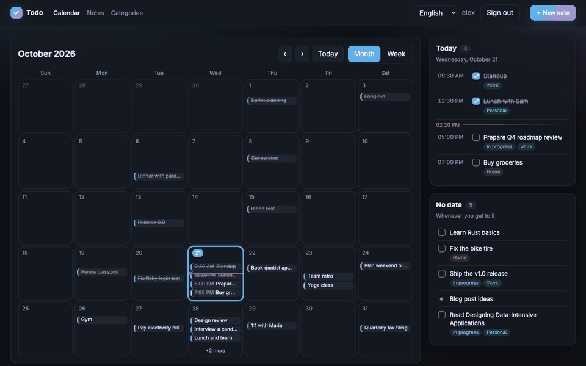
</div>

## Contents

- [Features](#features)
- [Built with](#built-with)
- [Screenshots](#screenshots)
- [Quick start](#quick-start)
- [Architecture](#architecture)
- [API](#api)
- [Local development](#local-development)
- [Quality](#quality)
- [Project structure](#project-structure)
- [Roadmap](#roadmap)
- [License](#license)

## Features

- 📅 **Calendar home page.** A month or week view where every task sits at its time of day,
  next to a **Today** list with a "now" line and a **No date** list. Click a day to plan
  something on it. On a phone, the page shows just Today and No date.
- 📝 **Notes and tasks.** A title, an optional body and due date, and a status: `todo`,
  `in_progress`, `done`, or none for a plain note.
- 🏷️ **Categories.** Any number per note, each with its own color in the calendar. Names are
  unique per user regardless of case, in any language.
- 🔎 **Filters that live in the URL.** On the Notes page: status, category, due date range and
  quick views (Today, Overdue, No due date), with pagination.
- 🌍 **English and Russian.** A language switcher, dates in the browser's locale and time zone,
  the first day of the week from the locale, and translated API errors.
- 🔐 **Private by default.** Sign up and sign in with JWT. Every user sees only their own data.
- 🗑️ **Soft delete.** Deleted records stay in the database and disappear from the API.
- 💾 **Nothing gets lost.** When a session expires, a sign-in dialog opens over the current page,
  and the editor keeps a local draft until the save succeeds.
- 🧬 **Typed end to end.** The OpenAPI snapshot generates the frontend types, so API drift breaks
  the build, not production.
- 🐳 **One-command deploy.** Docker Compose runs the backend, the SPA and a reverse proxy.

<p align="right">(<a href="#readme-top">back to top</a>)</p>

## Built with

<p>
  <a href="https://fastapi.tiangolo.com"></a>
  <a href="https://www.sqlalchemy.org"></a>
  <a href="https://docs.pydantic.dev"></a>
  <a href="https://sqlite.org"></a>
  <a href="https://alembic.sqlalchemy.org"></a>
  <a href="https://docs.astral.sh/uv/"></a>
</p>
<p>
  <a href="https://react.dev"></a>
  <a href="https://www.typescriptlang.org"></a>
  <a href="https://vite.dev"></a>
  <a href="https://tanstack.com"></a>
  <a href="https://www.i18next.com"></a>
</p>
<p>
  <a href="https://www.docker.com"></a>
  <a href="https://caddyserver.com"></a>
  <a href="https://github.com/features/actions"></a>
</p>

<p align="right">(<a href="#readme-top">back to top</a>)</p>

## Screenshots

<table>
  <tr>
    <td colspan="2">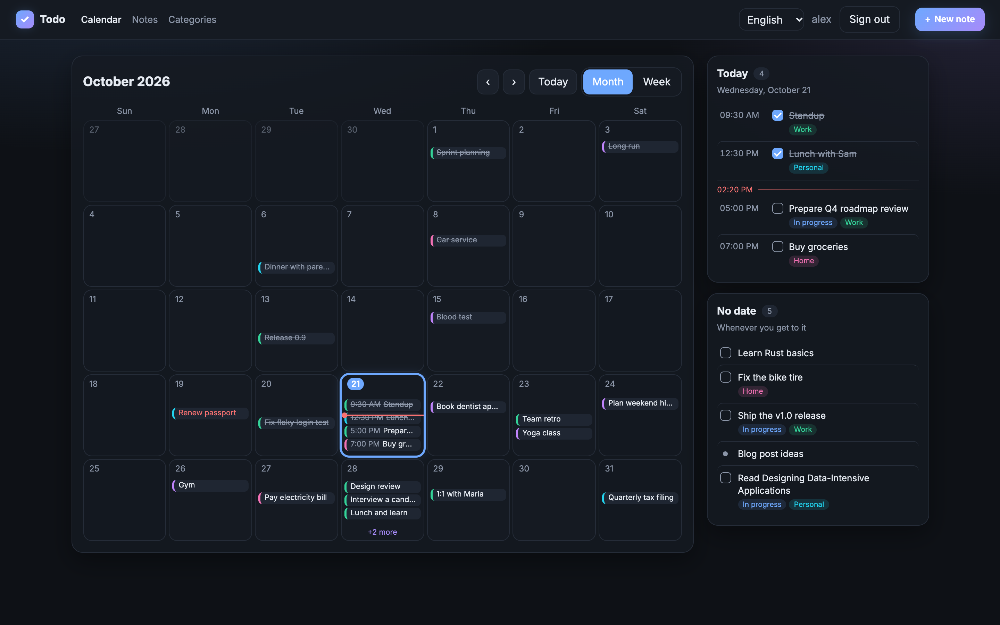<p align="center"><sub><b>Month</b>: tasks placed by time of day, the current time on today, overflow folded into "+N more"</sub></p></td>
  </tr>
  <tr>
    <td width="68%">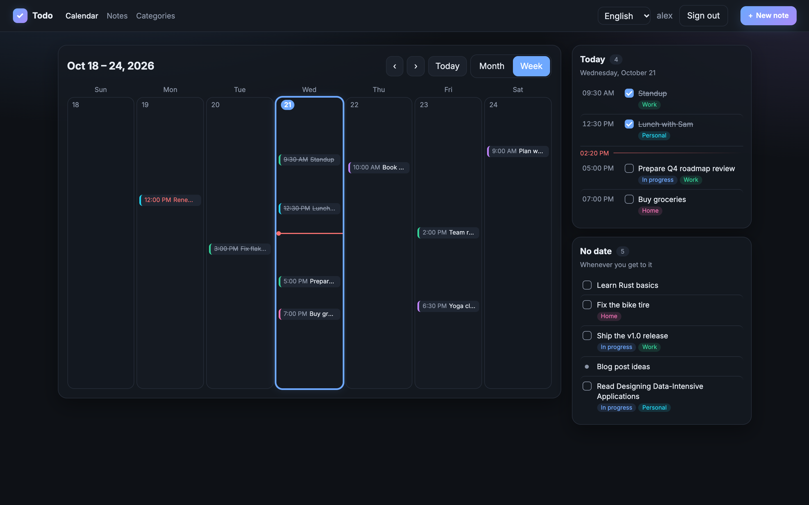<p align="center"><sub><b>Week</b>: the same time scale with more room per day</sub></p></td>
    <td width="32%">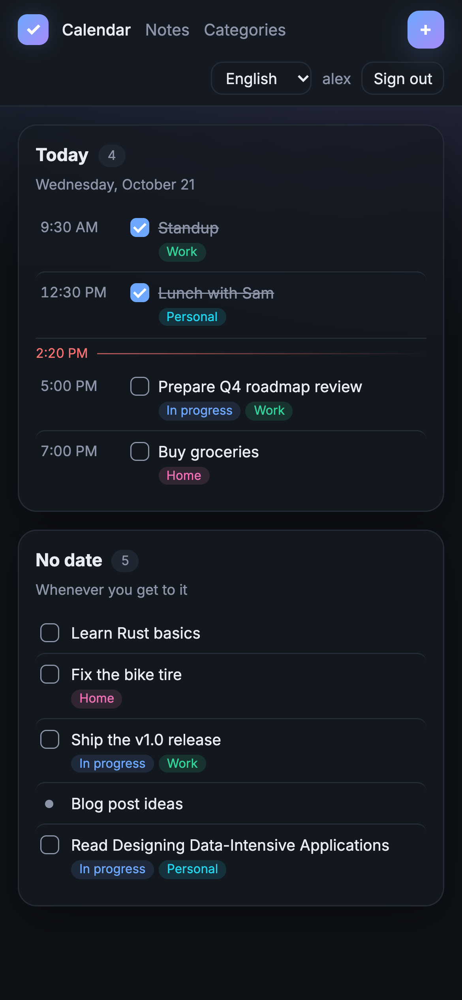<p align="center"><sub><b>Phone</b>: just Today and No date</sub></p></td>
  </tr>
  <tr>
    <td width="50%">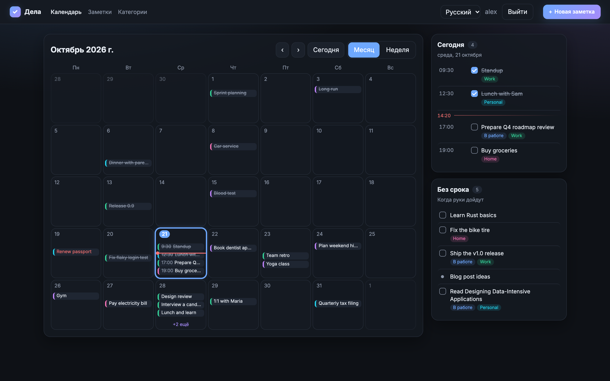<p align="center"><sub><b>Russian UI</b>: Monday first, 24-hour time</sub></p></td>
    <td width="50%">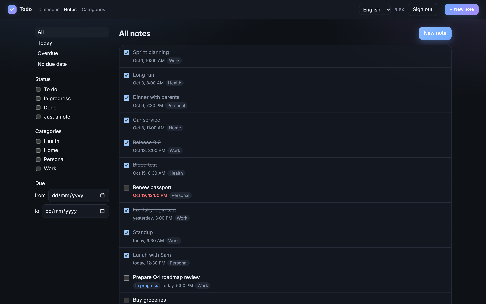<p align="center"><sub><b>Notes</b>: every note with filters kept in the URL</sub></p></td>
  </tr>
  <tr>
    <td width="50%">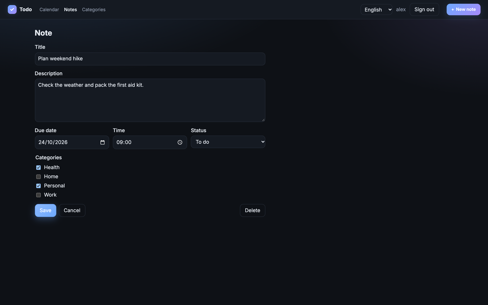<p align="center"><sub><b>Editor</b>: due date, status and categories</sub></p></td>
    <td width="50%">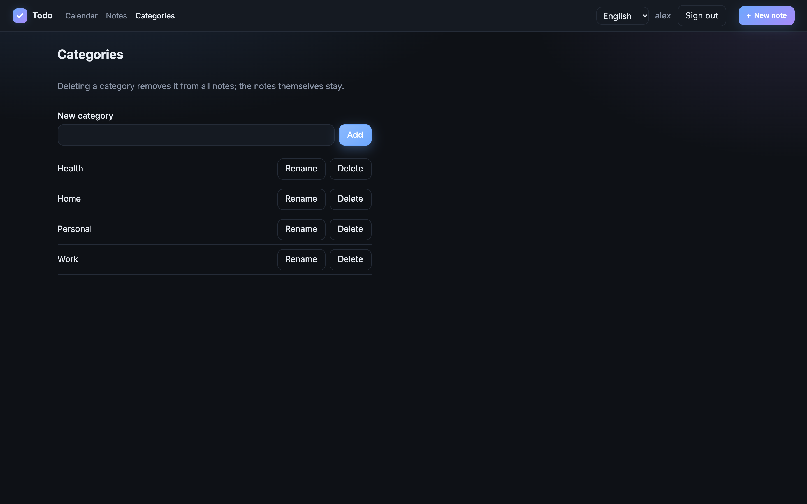<p align="center"><sub><b>Categories</b>: create, rename and delete</sub></p></td>
  </tr>
  <tr>
    <td width="50%">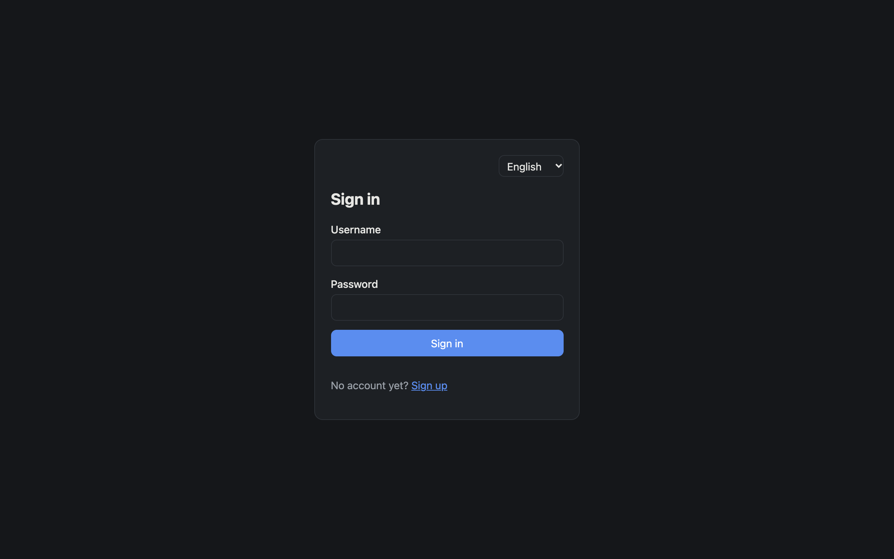<p align="center"><sub><b>Sign in</b>: with a language switcher</sub></p></td>
    <td width="50%">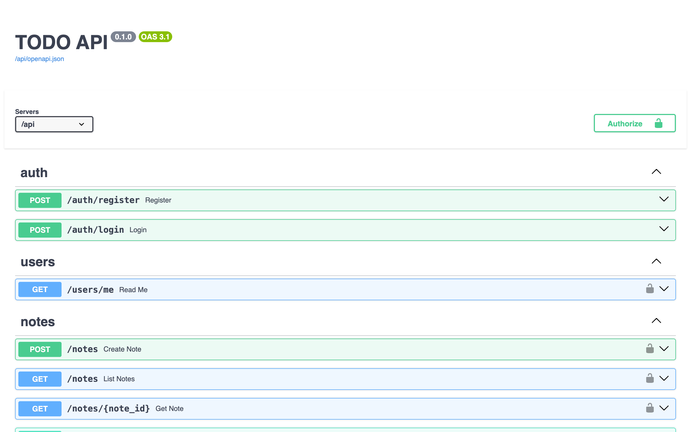<p align="center"><sub><b>Swagger UI</b>: every endpoint and error response in OpenAPI</sub></p></td>
  </tr>
</table>

<p align="right">(<a href="#readme-top">back to top</a>)</p>

## Quick start

Requirements: Docker with the Compose plugin.

```bash
git clone https://github.com/KonstantinVasilkov/todo-app.git
cd todo-app
export JWT_SECRET="$(python3 -c 'import secrets; print(secrets.token_urlsafe(48))')"
docker compose up -d --build
```

| URL | What |
|---|---|
| http://localhost:8080 | the app |
| http://localhost:8080/api | the API |
| http://localhost:8080/api/docs | Swagger UI |

```bash
docker compose down      # stop; data is kept
docker compose down -v   # stop and delete the database volume
```

<details>
<summary><b>What runs inside</b></summary>

- **`backend`** (`Dockerfile`):
  - Python 3.14 slim with dependencies installed by `uv` from `uv.lock`, running as an
    unprivileged user.
  - On start it applies migrations (`alembic upgrade head`), then runs
    `fastapi run --root-path /api` on port 8000.
  - The port is not published; only `web` reaches it.
  - SQLite lives in the `todo-data` volume at `/data/todo.db`.
- **`web`** (`docker/frontend.Dockerfile`):
  - Node builds the SPA, then Caddy serves it on port 80 (published as 8080).
  - Caddy falls back to `index.html` for client-side routes and proxies `/api/*` to `backend`
    with the prefix stripped.
  - It starts once the backend health check passes.

Caddy serves plain HTTP. To expose the app publicly, put it behind a TLS-terminating proxy or
give Caddy a domain name.

</details>

<details>
<summary><b>Configuration</b></summary>

| Variable | Default | Notes |
|---|---|---|
| `JWT_SECRET` | none | Required, at least 32 characters. Compose refuses to start without it. Can also be set in `.env` next to `docker-compose.yml`. |
| `JWT_ALGORITHM` | `HS256` | |
| `JWT_TTL_MINUTES` | `60` | |
| `DATABASE_URL` | `sqlite+aiosqlite:///./todo.db` | Set to `sqlite+aiosqlite:////data/todo.db` in the image. |

</details>

<p align="right">(<a href="#readme-top">back to top</a>)</p>

## Architecture

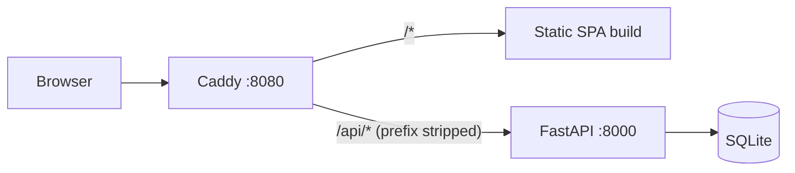

The browser talks to a single origin. The reverse proxy serves the built SPA and forwards
`/api/*` to the backend, so no CORS is needed. In development the Vite dev server plays the
proxy's role.

### Backend

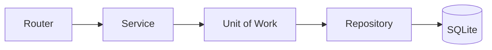

- **Routers** (`app/api/`) handle HTTP, validate input with Pydantic and map domain
  exceptions to status codes. They hold no business logic and no sessions.
- **Services** (`app/services/`) own the transaction:
  - each public method opens one `unit_of_work`, which yields a session and the repositories
    bound to it;
  - it commits on success and rolls back on any exception;
  - services return Pydantic schemas, never ORM objects, and never call each other.
- **Repositories** (`app/repositories/`) build queries and never commit. `BaseRepository`
  always filters out soft-deleted rows and other users' rows, and fills the audit fields.
- **Data model:**
  - `users`, `notes` and `categories` share one set of base fields: `id` (uuid4), `status`,
    `created_at`, `updated_at`, `created_by`, `updated_by` and `deleted_at`;
  - `created_by` is the owner;
  - notes and categories are linked many-to-many through `note_category`;
  - partial unique indexes ignore deleted rows;
  - category names compare by a `casefold()` key, so case-insensitivity works beyond ASCII.
- **Auth.** Passwords are hashed with argon2 (`pwdlib`). Access tokens are HS256 JWTs that live
  60 minutes.
- **Errors.** `409` and domain `422` responses use FastAPI's list format,
  `{"detail": [{"loc": [...], "msg": "...", "type": "conflict"}]}`, so clients handle both the
  same way. Every error response is described in the OpenAPI schema.
- **Migrations.** Alembic runs in async, batch mode, which SQLite needs to alter tables.

### API contract

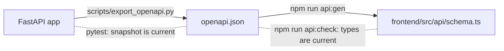

`openapi.json` in the repository root is a snapshot of the API schema:
- the backend owns it, and a test fails when it differs from the app;
- the frontend generates its types from it;
- a renamed endpoint, field or enum value breaks the frontend typecheck.

### Frontend

- **Routing and data.** TanStack Router keeps the calendar period and the Notes filters in
  typed URL search params. TanStack Query updates statuses optimistically across the
  calendar and both lists.
- **Calendar:**
  - month and week grids start on the locale's first day of the week;
  - each task is positioned by its time of day, and close tasks are pushed apart instead of
    overlapping;
  - category colors are derived from the category id, so the backend stores no colors;
  - the calendar loads every page of `GET /notes` for the visible range.
- **API client.** `openapi-fetch` is typed by the generated `paths`, and so are the MSW mocks in
  tests.
- **Session expiry.** A `401` opens a sign-in dialog over the current page, so unsaved input
  stays.
- **i18n.** `i18next` with English as the default and fallback language and Russian as the
  second one:
  - translation keys are typed, so a missing key is a compile error;
  - a test keeps both locales in sync;
  - API errors are translated by their `type` and field, with the server message as a fallback.

<p align="right">(<a href="#readme-top">back to top</a>)</p>

## API

All endpoints except `/auth/*` require `Authorization: Bearer <token>`.

| Method | Path | Description |
|---|---|---|
| `POST` | `/auth/register` | Create an account |
| `POST` | `/auth/login` | Get an access token (OAuth2 password form) |
| `GET` | `/users/me` | Current user |
| `GET` | `/notes` | List notes with filters and pagination |
| `POST` | `/notes` | Create a note |
| `GET` `PATCH` `DELETE` | `/notes/{id}` | Read, partially update or soft-delete a note |
| `GET` `POST` | `/categories` | List or create categories |
| `PATCH` `DELETE` | `/categories/{id}` | Rename or soft-delete a category |

`GET /notes` takes:
- **`status`**: repeatable; `todo`, `in_progress`, `done`, or `none` for plain notes;
- **`category_id`**: repeatable, matches notes in any of the categories;
- **`due_from`**, **`due_to`**: a due date range;
- **`has_due`**: notes with or without a due date;
- **`limit`** and **`offset`**: pagination, up to 100 per page.

Several values of one filter mean OR; different filters combine with AND.

<p align="right">(<a href="#readme-top">back to top</a>)</p>

## Local development

Requirements: Python 3.14 with [uv](https://docs.astral.sh/uv/), and Node.js 20.19 or newer
with npm 11. npm 10.8 fails on this lockfile; use `npx npm@11 install`.

```bash
cp .env.example .env   # then set JWT_SECRET
uv sync
uv run alembic upgrade head
uv run fastapi dev app/main.py --root-path /api
```

In another terminal:

```bash
cd frontend
npm install
npm run dev            # http://localhost:5173, proxies /api/* to http://localhost:8000
```

Set `API_URL` to point the dev proxy at another backend address. After changing the API,
refresh the contract and the frontend types:

```bash
uv run python scripts/export_openapi.py
cd frontend && npm run api:gen
```

<p align="right">(<a href="#readme-top">back to top</a>)</p>

## Quality

| Check | Command |
|---|---|
| Lint and format | `uv run ruff check . && uv run ruff format --check .` |
| Type check | `uv run ty check` |
| Backend tests | `uv run pytest` |
| Frontend: contract, typecheck, lint, tests | `cd frontend && npm run check` |

CI runs all of the above on every push and pull request, and builds the Docker images. The
backend tests also include a hygiene check: Cyrillic text is allowed only in
`frontend/src/i18n/locales/ru.json`.

To run the same checks locally before every push, enable the repository hooks once per clone:

```bash
git config core.hooksPath .githooks
```

<p align="right">(<a href="#readme-top">back to top</a>)</p>

## Project structure

```
app/                  FastAPI application
  api/                routers and dependencies
  services/           business logic, unit of work
  repositories/       data access
  models/             SQLAlchemy models
  schemas/            Pydantic schemas
migrations/           Alembic migrations
scripts/              export_openapi.py
tests/                backend tests
frontend/             React SPA
  src/api/            generated schema, client, error mapping, queries
  src/auth/           session, sign-in and sign-up
  src/features/       calendar, home page, notes and categories
  src/i18n/           i18n setup and locales (en.json, ru.json)
docker/               web image and Caddyfile
Dockerfile            backend image
docker-compose.yml    full stack
openapi.json          API contract snapshot
```

<p align="right">(<a href="#readme-top">back to top</a>)</p>

## Roadmap

- [x] Notes, categories, filters and pagination
- [x] Calendar home page with month and week views
- [x] English and Russian UI
- [x] Typed API contract checked in CI
- [x] One-command Docker deployment
- [ ] Sharing notes and categories with other users
- [ ] Due date reminders
- [ ] Subtasks and checklists
- [ ] Full-text search (SQLite FTS5)
- [ ] Refresh tokens and "sign out everywhere"
- [ ] Sync across devices. Soft delete already keeps the tombstones that incremental sync needs.
- [ ] PostgreSQL as a deployment option

<p align="right">(<a href="#readme-top">back to top</a>)</p>

## License

Distributed under the MIT License. See [`LICENSE`](LICENSE).

<p align="right">(<a href="#readme-top">back to top</a>)</p>
